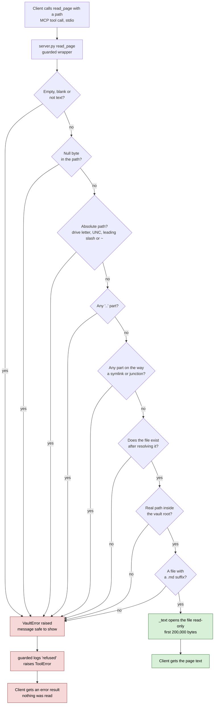

# vault-mcp

[](https://github.com/batutho-dot/vault-mcp/actions/workflows/tests.yml)

A small, read-only [MCP](https://modelcontextprotocol.io) server that lets an AI assistant
(Claude Code, Claude Desktop or any MCP client) search and read a folder of Markdown notes,
such as an Obsidian vault, and list its broken `[[wikilinks]]`. It cannot change, create or
delete anything, and it refuses every path that leads outside the folder.

It ships with a toy vault of 21 notes on basic energy and life cycle assessment (LCA) concepts,
written for this repository, so it runs without any private notes.

## Why read-only

MCP is a standard plug between an AI app and tools you write: the app starts the server, asks it
which tools it has, and calls them when a question needs them. That makes the server the place
where safety is decided. A notes folder often sits next to things the assistant should never see
or touch, so this server:

- offers only four tools, all marked `readOnlyHint: true`, and has no code path that writes;
- accepts only paths relative to the vault and refuses `..`, absolute paths (POSIX, drive
  letters, UNC), `~`, null bytes, symlinks and Windows junctions, and non-`.md` files;
- never follows symlinked folders when listing or searching.

## Tools

| Tool | What it returns |
|---|---|
| `list_pages(folder="")` | Every `.md` page (path and title), optionally inside one subfolder |
| `read_page(path)` | The full text of one page |
| `search(query, limit=10)` | Pages containing every word of the query, ranked by hits, with up to 3 matching lines each |
| `broken_links()` | Each `[[link]]` whose target page does not exist: page, line, target. Links in code are ignored; `[[Page\|alias]]` and `[[Page#Heading]]` are handled |

## How it is built

Two files do the work. `server.py` registers the four tools and turns refusals into MCP errors;
`vault.py` is the only code that touches the file system, and every `read_page` path goes
through `Vault.resolve`, which refuses the request at the first failed check:



The structure diagram, the `file:line` table and the checks not drawn here (listing, search,
vault root) are in [docs/architecture.md](docs/architecture.md).

## Run

Python 3.11 or newer.

```bash
pip install -e ".[test]"
vault-mcp --vault path/to/your/notes
```

Without `--vault` (or `$VAULT_ROOT`) it serves the bundled `toy-vault/`. The toy vault is
packed into the wheel too, so a plain `pip install .` or, with
[uv](https://docs.astral.sh/uv/), `uvx --from . vault-mcp` from a clone also serves it. A
`--vault` folder that does not exist stops the server at once with a one-line message.

Add it to Claude Code (run from the repository folder):

```bash
claude mcp add vault -- vault-mcp --vault ./toy-vault
```

For Claude Desktop, add an entry under `mcpServers` in `claude_desktop_config.json` with
`"command": "vault-mcp"` and `"args": ["--vault", "/absolute/path/to/notes"]`.

## Example

Asked "what is the COP of a heat pump?", the model calls `search(query="coefficient performance")`
and gets:

```json
[
  {
    "path": "energy/Heat Pumps.md",
    "title": "Heat Pumps",
    "score": 2,
    "matches": [
      {"line": 11, "text": "Its efficiency is the coefficient of performance (COP): heat delivered divided by electricity"}
    ]
  }
]
```

It then calls `read_page(path="energy/Heat Pumps.md")` for the full note. A request such as
`read_page(path="../README.md")` comes back as a tool error:
`'..' is refused; paths must stay inside the vault`.

## Tests

```bash
pytest -rs
```

49 tests. `tests/test_vault.py` has 35: 6 for normal use, 21 refusals (paths and folders),
6 symlink and junction cases, 2 write checks. `tests/test_server.py` has 14 end-to-end cases
through a real MCP client connected in-process, plus start-up checks (missing vault folder,
default toy vault). On the development machine (Windows 11, Python 3.13, `mcp` 2.3.0) the
result was **46 passed, 3 skipped**.

`python verify.py` runs everything in about 6 seconds: a compile check, the tests, then a real
run that starts the server as a subprocess over stdio on the toy vault and compares its
`broken_links` output with the known-good copy in `verify-features/expected_broken_links.json`,
and finally builds the wheel and checks it carries the 21 toy-vault pages.
It ends with `verify: PASS` or `verify: FAIL at <step>: <reason>`. `verify-features/` describes
what each check covers. The 3 skipped tests create real symlinks, which Windows
allows only with admin rights or Developer Mode. Their logic is still covered on Windows by a
junction test and a test that fakes a symlink on one path part; the GitHub Actions workflow runs
the tests and `verify.py` on every push, on Ubuntu (Python 3.11 and 3.13) and Windows (3.13).

The write checks are: the tool list is exactly the four read tools, all marked read-only; calls
to `write_page`, `delete_page`, `create_page` and `edit_page` fail; every file in the vault has
the same SHA-256 hash before and after calling every tool; and the source contains no
file-writing call.

## Trying it from Claude Code

`eval/questions.md` holds 10 questions with known answers in the toy vault, plus a broken-link
check and an escape attempt. They were run once with Claude Code in print mode
(`claude -p`, model `sonnet`, 2026-11-19), with only this server's four tools allowed and the
built-in file tools blocked, so every answer had to come through the server.

| Check | Result |
|---|---|
| Questions answered correctly (scored by hand against the notes) | **10 / 10** |
| Of those, questions with no answer in the vault, correctly answered "not in the vault" | 2 / 2 |
| Planted broken links found | **7 / 7**, 0 false positives |
| Link inside a code block (should be ignored) | ignored |
| `read_page("../README.md")` | refused: `'..' is refused; paths must stay inside the vault` |
| Cost and time of the run, as reported by Claude Code | 0.195 USD, 17 turns, 19 s |

The planted broken links are listed in `tests/test_vault.py` (`PLANTED`), and a test checks that
`broken_links()` returns exactly that set.

## What failed or is weak

- One run of 10 questions is a smoke test, not an evaluation. The questions were written by the
  same author as the notes, so they are easier than real use.
- Question 8 ("which pages link to District Heating?") was answered by text search. There is no
  backlinks tool, so a page that mentions the name without linking would be counted too.
- First attempt at the source check banned the word `symlink` and failed on the server's own
  docstring; it now bans `os.symlink` only.
- Deleting the `..` rule on purpose did not make any test fail, because the second check
  (resolve the path, then confirm it is inside the vault) still blocked every escape. Good for
  safety, but the `..` rule itself was untested. A test now asks for `lca/../index.md`, which
  stays inside the vault and must still be refused.

## Limits

- Search is plain word matching, no stemming or ranking beyond hit counts. Fine for a few hundred
  notes, not for tens of thousands.
- Pages are read up to 200 kB each.
- Link matching is by file name or vault-relative path, case-insensitive, like Obsidian's
  default. Links to images and other attachments are reported as broken.
- Read-only is enforced by what the code does, not by the operating system. For a hard
  guarantee, also run the server as a user who has read-only rights on the folder.
- Not tested on macOS. Claude Desktop was not tried, only Claude Code.

## Licence

MIT. The toy vault is written for this repository and may be reused freely.
