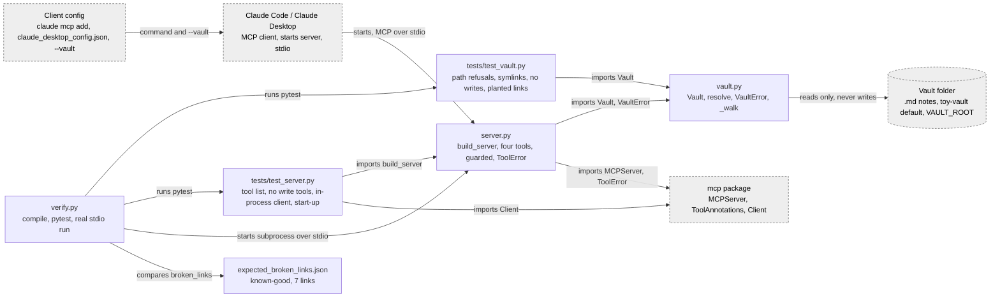
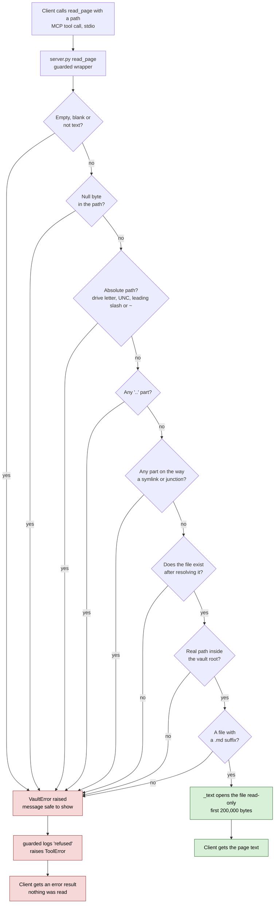

# Architecture

## 1. Structure

Shaded boxes are outside the repository.

| Box | `file:line` of the main function | What it does |
|---|---|---|
| Client config | `README.md:85` (the `claude mcp add` line) | Says which command starts the server and which folder to serve. |
| Claude Code / Claude Desktop | outside the repository | Starts the server, sends tool calls over stdio. |
| `server.py` | `src/vault_mcp/server.py:31` (`build_server`) | Registers the four read-only tools, turns `VaultError` into `ToolError`. Entry: `main` at `server.py:91`, which exits with one line if the vault folder is missing. |
| `vault.py` | `src/vault_mcp/vault.py:49` (`Vault.resolve`) | All file access: path to file or refusal, listing, search, broken links. |
| Vault folder | outside the repository (opened at `vault.py:39`) | The Markdown notes, the bundled `toy-vault/` unless `--vault` or `$VAULT_ROOT` says otherwise. |
| `mcp` package | outside the repository (`pyproject.toml:8`) | Server class, tool error type, test client. |
| `tests/test_vault.py` | `tests/test_vault.py:99` (`test_refuses_escaping_paths`) | `Vault` directly: reads, 14 escaping paths, symlinks and junctions, no file changes. |
| `tests/test_server.py` | `tests/test_server.py:52` (`test_read_page_refuses_outside_paths`) | In-process MCP client: tool list, no write tools, outside paths are errors. |
| `verify.py` | `verify.py:82` (`main`) | Compile, tests, one real stdio session on the toy vault. |
| `expected_broken_links.json` | `verify-features/expected_broken_links.json:1` | The known-good list of the 7 broken links planted in the toy vault. |

## 2. Decision flow of a `read_page` request

Every check is in `Vault.resolve`. The first failure refuses the request.

| Step | `file:line` | What it does |
|---|---|---|
| Tool entry | `src/vault_mcp/server.py:58` | Hands the path to `guarded` and `Vault.read_page`. |
| `guarded` | `src/vault_mcp/server.py:41` | Logs `VaultError` to stderr, re-raises as `ToolError`. |
| Empty or not text | `src/vault_mcp/vault.py:56` | Blank or non-string path. |
| Null byte | `src/vault_mcp/vault.py:58` | `\x00` in the path. |
| Absolute path | `src/vault_mcp/vault.py:60` | Drive letters, UNC, a leading `/`, `\` or `~`. |
| `..` part | `src/vault_mcp/vault.py:63` | Any `..`, even one that stays inside the vault. |
| Symlink or junction | `src/vault_mcp/vault.py:66` | Every path part on the way down. |
| Exists | `src/vault_mcp/vault.py:74` | A missing file is "no such page". |
| Inside the root | `src/vault_mcp/vault.py:78` | Real path outside the vault root. |
| `.md` file | `src/vault_mcp/vault.py:80` | Folders and non-Markdown files. |
| Read | `src/vault_mcp/vault.py:126` | Opens read-only, up to 200,000 bytes. |

Not drawn:

- `list_pages` does not call `resolve`. Its folder check (`vault.py:107`) refuses `..`, a drive letter and a null byte, and the folder must exist. Its file walk (`vault.py:86`) skips folders starting with `.` and any symlink or junction. `search` and `broken_links` use it too.
- `Vault.__init__` (`vault.py:39`) refuses a vault root that is not a folder or is itself a symlink or junction.
