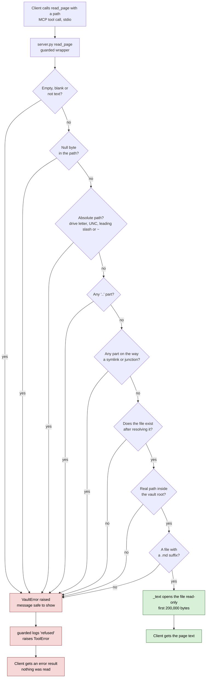

# Architecture

How `vault-mcp` is put together, drawn from the code. Two views: the structure (which file
talks to which, and who is outside the repository), and the decision flow a `read_page`
request goes through before it is served or refused.

## 1. Structure

Solid boxes are files in this repository. Shaded boxes are outside it. Arrows point from the
caller to the thing it calls or reads.

| Box | `file:line` of the main function | What it does |
|---|---|---|
| Client config | `README.md:85` (the `claude mcp add` line) | Tells Claude Code or Claude Desktop which command starts the server and which folder to serve. |
| Claude Code / Claude Desktop | outside the repository | The MCP client that starts the server as a subprocess and sends it tool calls over stdio. |
| `server.py` | `src/vault_mcp/server.py:29` (`build_server`) | Creates the MCP server, registers `list_pages`, `read_page`, `search` and `broken_links` as read-only tools, and turns every `VaultError` into a `ToolError`. The command line entry is `main` at `server.py:89`. |
| `vault.py` | `src/vault_mcp/vault.py:49` (`Vault.resolve`) | Holds all file access: it turns a vault-relative path into a real file or refuses, and implements listing, search and broken-link finding. |
| Vault folder | outside the repository (opened at `vault.py:39`) | The folder of Markdown notes being served; the bundled `toy-vault/` unless `--vault` or `$VAULT_ROOT` says otherwise. |
| `mcp` package | outside the repository (`pyproject.toml:8`) | The MCP library that supplies the server class, the tool error type and the test client. |
| `tests/test_vault.py` | `tests/test_vault.py:99` (`test_refuses_escaping_paths`) | Checks `Vault` directly: normal reads, 14 escaping paths, symlinks and junctions, and that no call changes a file. |
| `tests/test_server.py` | `tests/test_server.py:52` (`test_read_page_refuses_outside_paths`) | Connects a real MCP client in-process and checks the tool list, that write tools do not exist, and that outside paths come back as errors. |
| `verify.py` | `verify.py:82` (`main`) | Runs the compile check, the test suite and one real stdio session on the toy vault, then prints PASS or FAIL. |
| `expected_broken_links.json` | `verify-features/expected_broken_links.json:1` | The known-good list of the 7 broken links planted in the toy vault, used by `verify.py` for comparison. |

## 2. Decision flow of a `read_page` request

Every check is in `Vault.resolve`. The first failing check refuses the request, and the
client gets an error result. Only a path that passes all of them is opened, read-only.

| Step | `file:line` | What it does |
|---|---|---|
| Tool entry | `src/vault_mcp/server.py:56` | The `read_page` tool hands the path to `guarded` and `Vault.read_page`. |
| `guarded` | `src/vault_mcp/server.py:39` | Catches `VaultError`, logs it to stderr and re-raises it as a `ToolError`. |
| Empty or not text | `src/vault_mcp/vault.py:56` | Refuses a blank or non-string path. |
| Null byte | `src/vault_mcp/vault.py:58` | Refuses a path containing `\x00`. |
| Absolute path | `src/vault_mcp/vault.py:60` | Refuses drive letters, UNC paths, and anything starting with `/`, `\` or `~`. |
| `..` part | `src/vault_mcp/vault.py:63` | Refuses any `..`, even one that would stay inside the vault. |
| Symlink or junction | `src/vault_mcp/vault.py:66` | Checks every path part on the way down. |
| Exists | `src/vault_mcp/vault.py:74` | Resolves the path strictly; a missing file is refused as "no such page". |
| Inside the root | `src/vault_mcp/vault.py:78` | Refuses a real path that is not under the vault root. |
| `.md` file | `src/vault_mcp/vault.py:80` | Refuses folders and any file that is not Markdown. |
| Read | `src/vault_mcp/vault.py:123` | Opens the file in read mode and returns up to 200,000 bytes. |

Not drawn above:

- `list_pages` does not call `resolve`. It has its own folder check (`vault.py:106`: no `..`,
  no drive letter), and its file walk (`vault.py:86`) skips folders starting with `.` and any
  symlink or junction. `search` and `broken_links` use the same walk.
- `Vault.__init__` (`vault.py:39`) refuses a vault root that is not a folder or is itself a
  symlink or junction.
